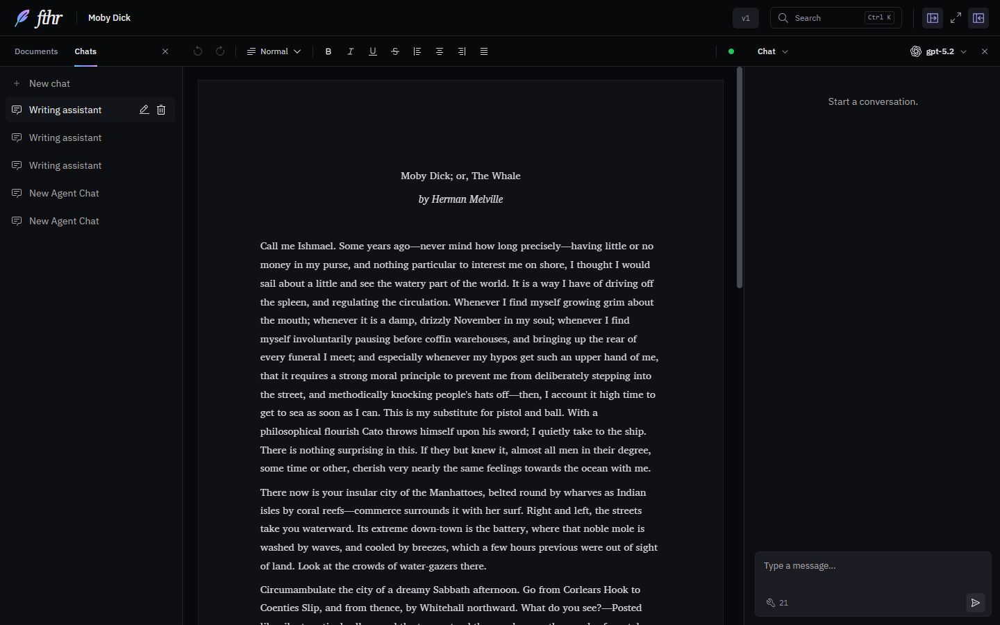
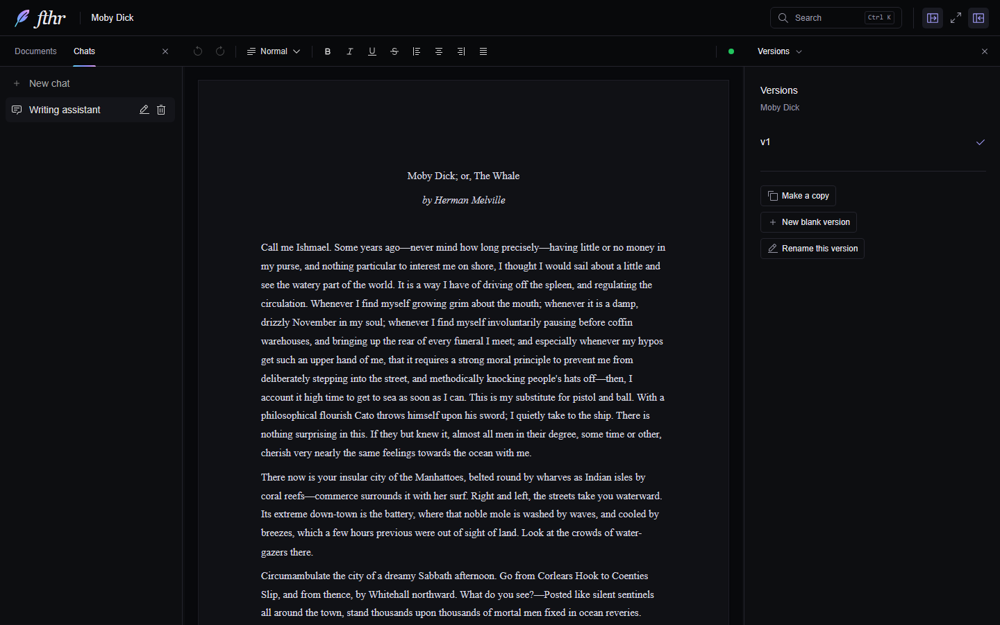
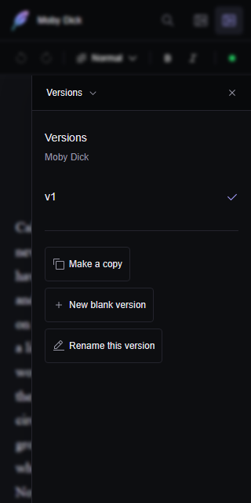

# Named writing versions

Manage named writing versions from **right-pane dropdown → Versions**, or open **Search → Document versions**. This panel brings together the writing-version controls introduced in issue [#15](https://github.com/darrylschaefer/fthr/issues/15).

## Behavior and scope

- Use the panel to switch versions, make a copy of the current writing, start a blank version, or rename the current version. Names are trimmed, limited to 60 characters, and unique within the document.
- New documents start with one version, **v1**. Copy and blank-version dialogs suggest **v2**, **v3**, and so on, skipping a suggestion already used by another version. Writers can enter their own names.
- Existing Draft and Finished writing stays available as **v1** and **v2**, with any explicit custom names preserved. Each added version has independent text, formatting, block identities, revision history, and editor undo history. Copy includes current unsaved writing; switching flushes the outgoing version. Reported save failures keep that writing visible and block switching or copying.
- Notes, document title, folders, metadata, agents, and macros remain shared. Switching versions clears a selection owned by the outgoing editor. Current-version reads, selected text, macros, search, and document tools resolve the selected version by its stable ID. Agent requests include the active version ID and available version names.
- Cancellation and document/version changes invalidate pending creation. Duplicate submissions create one version, and the latest switch request wins while a save is pending. Renaming changes the label without changing the version's identity or remounting its editor.
- The panel uses the same headings, spacing, and action buttons as Notes, History, Tools, and Meta. Phone layouts use the right drawer, with 44-pixel touch targets. Creation and rename dialogs return focus to the action that opened them.

Version deletion, automatic AI-created branches, comparisons between arbitrary named versions, provider changes, and narrative/folder restructuring are outside this PR.

## Compatibility, checkpoints, and rollback

This is an additive format change, without an IndexedDB schema migration. Existing Draft and Finished keep their fields and stable IDs, with `v1`/`v2` as their default display labels and optional custom names. A new document omits the unused legacy Finished field, so it starts with only v1. Duplication and checkpoints retain that shape. Additional versions are stored as records with stable IDs, names, serialized editor states, creation times, and optional copy origins. An older draft stored only in `editorState` is preserved before changing the active version. A deliberately blank version does not fall back to another version's text.

Whole-document duplication retains all writing versions and names with fresh version/block identities. Existing document JSON exports include the additional fields. Import validates version IDs, names, the selected version, and the basic serialized-state shape. It does not fully validate arbitrary Lexical node schemas.

New checkpoints capture every writing version, shared Notes, and document metadata. Old checkpoints remain readable. History previews the selected version and explains when that version was absent from a checkpoint. Restore replaces versions captured by that checkpoint, Notes, and metadata, while preserving versions created later. Restoring still requires confirmation and clears editor undo history. Make a checkpoint before restoring if the current state needs to be retained.

Reverting the application code hides the added versions because older code only understands Draft and Finished. Preserve a JSON export and avoid editing/exporting through an older build until recovery is planned; an older build can overwrite fields it does not understand. Separate checkpoint records remain excluded from JSON exports, as before.

## Validation and limits

The original named-version implementation passed `npm run check` with 264 tests in 13 files and the production build. The focused integration suite uses real Workspace/Lexical and document actions with synthetic writing, an in-memory checkpoint store, and mocked unrelated services. It covers numbered defaults, a single starting version through duplication/checkpoint recovery, formatted unsaved copies, independent edits/reload, blank versions, rename, legacy records, failed saves, pending/canceled actions, selection/macros, actual AI block-edit application, checkpoint recovery, document duplication, and malformed version data. Existing toolbar, selection, Notes, and History regressions remain included.

Browser checks use a separate localhost origin with the bundled sample manuscript and a synthetic alternative opening. They verify copying, editing, switching back to the intact original, rename, persisted content after reload, keyboard dismissal, both themes, and the 390 × 844 phone menu/dialog. No API key or paid AI request is used.

The October 25 pane relocation passed `npm run check` with **527 tests in 37 files**, application/test/browser typechecks, and the production build. Chromium checks verified version actions, Search navigation, desktop and 390/320-pixel phone layouts, matching section styles, and 44-pixel touch targets. There were no browser runtime errors.

Provider response quality, native Electron packages, physical phone input, other browser engines, and exhaustive IndexedDB failure/recovery are outside these local checks. The autosave status still reflects the existing persistence mechanism rather than a new durable-write acknowledgment. The pane relocation changes no stored version data. Existing dependency and bundle-size warnings are unchanged.

## Screenshots

Before: the standalone version control in the title bar.

Current desktop and phone panels:

